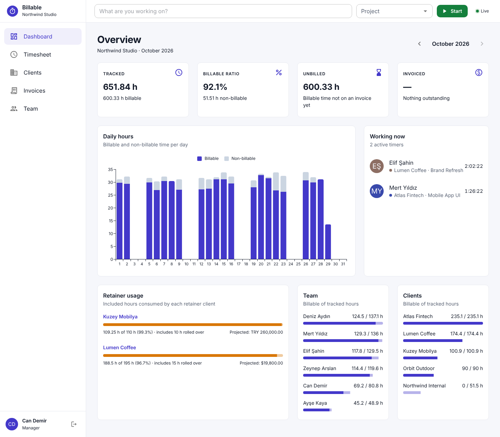

# Billable

Time tracking and invoicing for agencies. Team members track their hours against client projects, and managers turn each month's time into invoices based on the client's contract.

## Public portfolio demo

[Open the live demo](https://billable-time-tracking.onrender.com/)

The Render demo opens directly as the demo manager, with sample clients, contracts,
timesheets and invoices. Sign out to try the team-member account from the login page.

The deployment in `deploy/Dockerfile` runs the original Django API and PostgreSQL
alongside the built React app on one free Render web service. It uses a single
Uvicorn process with an in-memory Channels layer and eager Celery tasks; emails are
discarded. The normal production settings and Docker Compose stack remain available.

This is a disposable, shared demo: all sample data is recreated on startup and
changes are lost on service restarts. Do not enter real client or personal data.
Render's free service sleeps after inactivity, so the first visit can take about
a minute to start. See `render.yaml` for repeatable free-plan configuration.

## Features

- Start/stop timer and a weekly timesheet
- Live "who's working now" view over WebSockets
- Hourly, monthly retainer (with overage and rollover) and fixed-fee contracts
- Monthly invoice generation with preview, tax, sequential numbering and CSV export
- Dashboard with tracked vs billable hours, retainer usage and revenue
- Owner, manager and member roles

## Tech stack

**Backend:** Python 3.13, Django 6, Django REST Framework, Django Channels, Celery, PostgreSQL, Redis, JWT authentication, OpenAPI (drf-spectacular), pytest

**Frontend:** React 19, TypeScript, Vite, Redux Toolkit Query, Material UI, React Hook Form, Zod, Vitest

**Tooling:** Docker Compose, nginx, GitHub Actions, Ruff, mypy, ESLint, Prettier

## Security and local configuration

The browser keeps the access token in memory. The refresh token is a host-only,
HttpOnly, SameSite=Strict cookie scoped to `/api/v1/auth/`; it is Secure when HTTPS
is enabled. Only a session-presence flag is stored in localStorage. Serve the UI
and API on the same origin. Login, refresh and logout require Django CSRF
validation: obtain `csrf_token` from `GET /api/v1/auth/csrf/` and send it as
`X-CSRFToken`. Login rotates that token and returns the replacement with `access`.
Refresh tokens are never returned in JSON. Logout revokes the server session,
including previously issued access tokens and open activity connections. Rotated
refresh tokens are blacklisted; sessions have an absolute expiration.

For a local Docker Compose deployment, copy `.env.example` to `.env` and generate
independent values for all four variables. Use `python3 -c "import secrets;
print(secrets.token_urlsafe(64))"` for `DJANGO_SECRET_KEY` and
`python3 -c "import secrets; print(secrets.token_hex(32))"` separately for each
password. Do not commit `.env`. Then run `docker compose up --build`. These settings
serve HTTP on localhost:8080; a public installation must configure TLS, exact
allowed hosts and CSRF/WebSocket origins, and enable `DJANGO_HTTPS_ONLY`.
The initialization script creates a database role without superuser privileges
and installs the required extension. Existing PostgreSQL volumes retain their
previous roles and passwords and require an explicit administrator migration.

The demo uses a fresh random signing key on every startup and PostgreSQL peer
authentication over a local Unix socket, with TCP disabled. Demo accounts cannot
change profiles, roles, account availability or organization settings. None has
Django staff/superuser privileges; the owner has no usable password. `seed_demo`
refuses to run outside explicit demo or development settings. Admin and API docs
are unavailable on the public demo; API docs are enabled only in development by
default. Production refuses missing or short signing keys and a missing database
URL. Application source files are not writable by the web process.

Security headers restrict script execution, framing, browser capabilities and API
caching. CSV exports escape formula-leading text. Login throttles use both client
address and normalized account identity (the shared demo skips the account-wide
limit). Throttling is an application safeguard, not a guarantee against denial of
service; public production needs appropriate edge protection. The demo remains a
shared, disposable workspace and must contain only sample data.

CI runs backend/frontend tests, Python and npm vulnerability audits, a redacted
Gitleaks scan of Git history and Docker builds. GitHub Actions are pinned to
verified commit revisions. Run `celery --app config beat` alongside the worker in
normal production to purge expired sessions/tokens daily; the demo discards its
database on service restarts.
